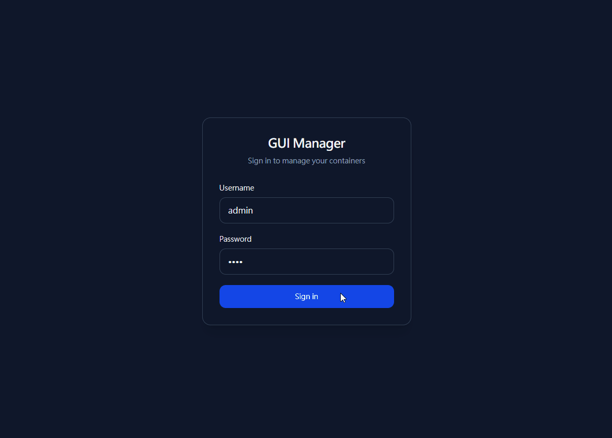
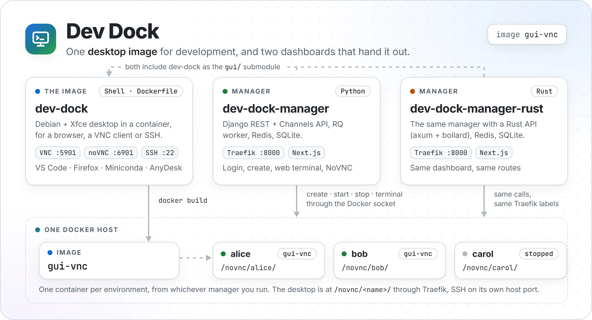
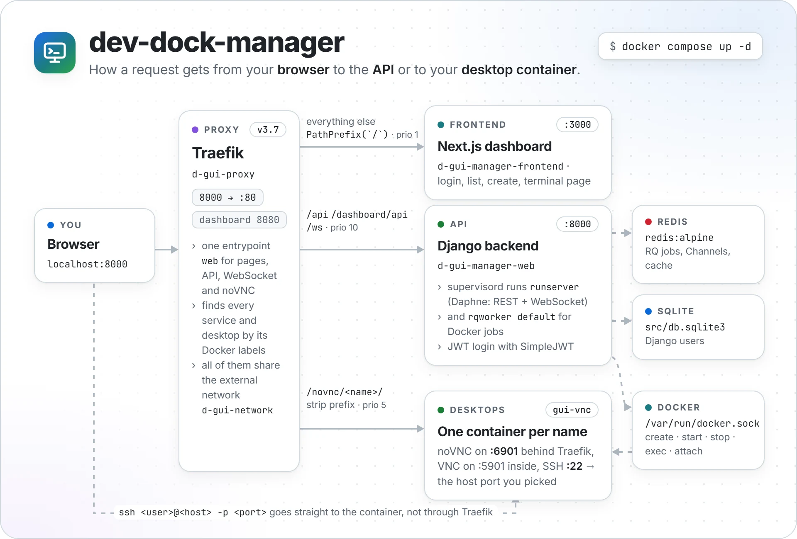
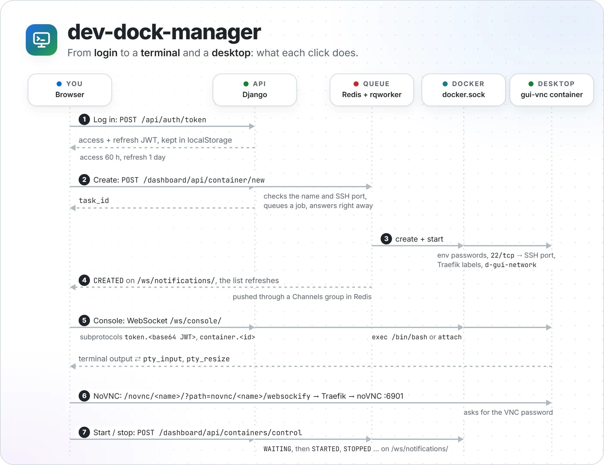
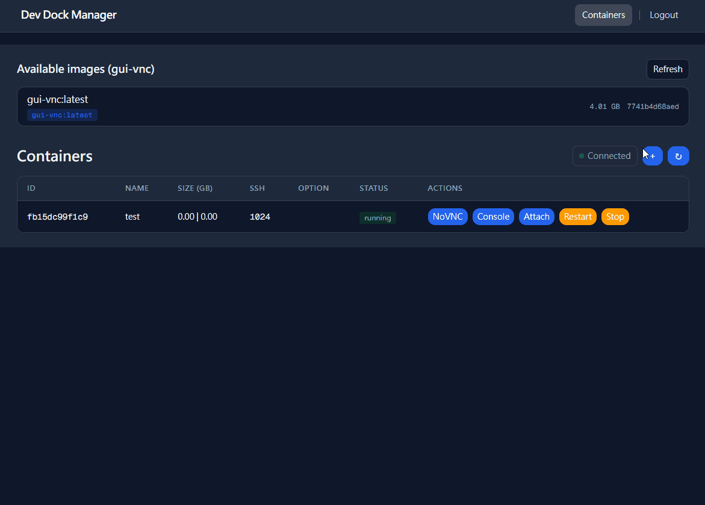
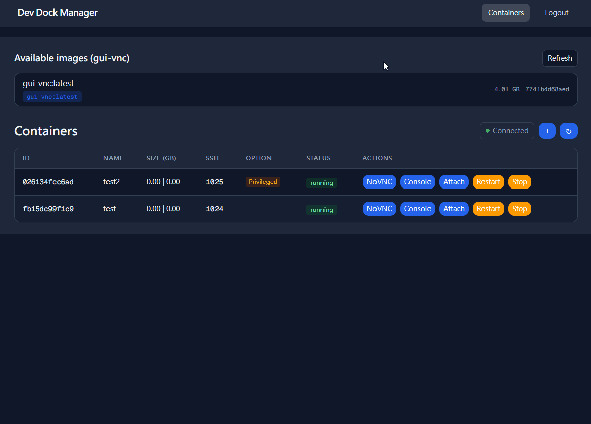
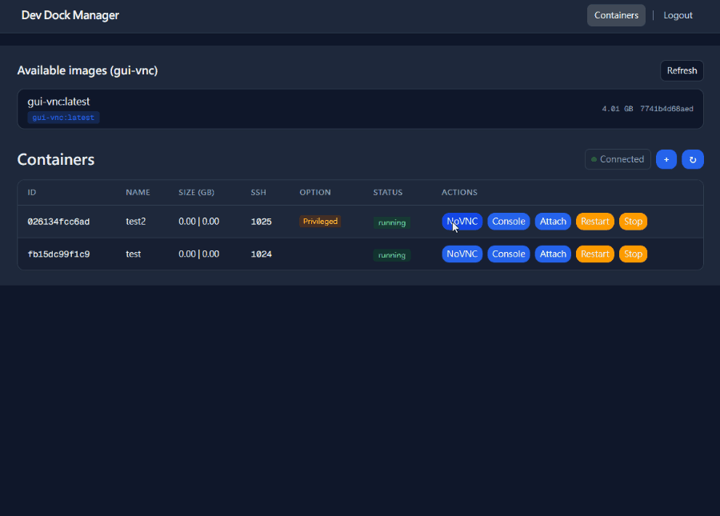

<div align="center" style="text-align: center">

# **Dev Dock Manager**

<p style="text-align: center">
  
</p>

<a href="./LICENSE"></a>

</div>

Dev Dock Manager is a small self-hosted dashboard for handing out Linux desktops on one machine. Each person
logs in, creates a container from the [dev-dock](https://github.com/NatLee/dev-dock) image, and gets a full
Xfce desktop in the browser (NoVNC), a web terminal and an SSH port, without touching Docker themselves. The
API is Django (with Django REST framework and Channels for WebSockets), the dashboard is Next.js, and Traefik
sits in front of both.

> **Starting fresh? Use [dev-dock-manager-rust](https://github.com/NatLee/dev-dock-manager-rust).** It's the
> same dashboard, permissions and account pages with a much lighter backend (numbers below). This Django
> version stays maintained as the older alternative, for example if you want the Django admin or Python.

It grew out of [dev-dock](https://github.com/NatLee/dev-dock) and
[Django Docker GUI](https://github.com/NatLee/django-docker-gui) (a web UI for Docker with a terminal).

## The Dev Dock family

<p align="center">
  <picture>
    <source media="(prefers-color-scheme: dark)" srcset="docs/images/family-dark.webp">
    
  </picture>
</p>

| Repo | What it is |
|---|---|
| [dev-dock](https://github.com/NatLee/dev-dock) | The `gui-vnc` image: Xfce desktop, VNC, noVNC and SSH in one container. Included here as `gui/`. |
| [dev-dock-manager-rust](https://github.com/NatLee/dev-dock-manager-rust) | **The recommended manager.** The same dashboard with a Rust API. |
| **dev-dock-manager** (this repo) | The older version, with a Django (Python) API. |

The two managers look the same from the browser, enforce the same permissions and start the same
containers, so pick one per machine. Measured side by side on the same machine (medians; how it was measured
is in the [Rust README](https://github.com/NatLee/dev-dock-manager-rust#why-this-one)):

| Measured (median) | dev-dock-manager (this repo) | dev-dock-manager-rust |
|---|---|---|
| Backend image size | 687 MB | 144 MB |
| Backend memory when idle | 256 MiB | 5.0 MiB |
| Start-up (`docker start` → API answers) | 8.3 s | 0.58 s |
| Log in | 129 ms | 18 ms |
| Container list | 3,185 ms | 478 ms |
| Image list | 4,973 ms | 324 ms |

The slow list endpoints come from docker-py: it inspects every image one by one, and the container list
also asks Docker for disk usage. Start-up includes applying migrations, collecting static files and
`runserver` with its auto-reloader.

| | dev-dock-manager | dev-dock-manager-rust |
|---|---|---|
| API | Django + Daphne, run by supervisord | one Rust binary (axum, bollard) |
| Background jobs | a separate `rqworker` process (RQ) | a worker task inside the API process |
| Users | Django users in SQLite | `users` table in SQLite, Argon2 password hashes |
| Login tokens | access 60 hours, refresh 1 day | access 1 hour, refresh 1 day |
| Extras | Django admin, Swagger and RQ pages | `/health` |

## How it works

<p align="center">
  <picture>
    <source media="(prefers-color-scheme: dark)" srcset="docs/images/architecture-dark.webp">
    
  </picture>
</p>

Everything you open goes through **Traefik** on port 8000, which picks the target by path:

| Path | Goes to |
|---|---|
| `/api/*`, `/dashboard/api/*`, `/ws/*` | the Django backend (`d-gui-manager-web`, port 8000) |
| `/novnc/<name>/` | the noVNC page of the desktop called `<name>` (port 6901), with the prefix stripped |
| everything else | the Next.js dashboard (`d-gui-manager-frontend`, port 3000) |

Traefik learns these routes from Docker labels. The services get theirs from `docker-compose.yml`, and each
desktop gets its own when the backend creates it. All of them share the external network `d-gui-network`. SSH
is the one thing that skips Traefik: each desktop publishes port 22 on a host port you choose.

Inside `d-gui-manager-web`, supervisord runs two programs: Daphne (the ASGI server from Channels, so the same
process handles REST calls and WebSockets) and `manage.py rqworker default`, which does the Docker work. Redis
(`d-gui-manager-redis`) carries the job queue, the WebSocket notifications and the cache.

<p align="center">
  <picture>
    <source media="(prefers-color-scheme: dark)" srcset="docs/images/lifecycle-dark.webp">
    
  </picture>
</p>

What each click does:

1. **Log in.** The dashboard posts your username and password to `/api/auth/token` and keeps the access and
   refresh tokens (JWT) in the browser's localStorage. Every API call sends the access token.
2. **Create.** The API checks the name (two characters or more, starting with a letter) and that the SSH port
   is free, puts an RQ job on Redis and answers with a `task_id` right away. Only admins may tick "privileged".
3. **`rqworker` starts the container** from `gui-vnc`: your passwords as environment variables, port 22 on the
   SSH port you picked, `/etc/localtime` mounted read-only, the Traefik labels for `/novnc/<name>/`, and
   optionally privileged mode or all NVIDIA GPUs, plus the `dev-dock.owner` label with your user id.
4. **The list refreshes** when `CREATED` arrives on the `/ws/notifications/` WebSocket. Notifications only go
   to the desktop's owner and to admins.
5. **Console** (your own desktops only; admins: any) opens a WebSocket to `/ws/console/` with two subprotocols, `token.<base64 JWT>` and
   `container.<id>`, and gets a `bash` started with `docker exec` (a root shell). **Attach** connects to the
   container's main process instead. Keys and window size go up as `pty_input` and `pty_resize`.
6. **NoVNC** opens `/novnc/<name>/` through Traefik and asks for the VNC password you set when creating it.
7. **Start, stop, restart, remove** go through the same queue. You see `WAITING`, then `STARTED`, `STOPPED` and so on.

## Interface

- Create container

    

- Web Terminal

    

- NoVNC

    

## Quick start

You need Linux with Docker running (the backend talks to `/var/run/docker.sock`). On Windows, use Docker inside WSL.

1. **Get the code with the image submodule:**

   ```bash
   git clone --recurse-submodules https://github.com/NatLee/dev-dock-manager.git
   cd dev-dock-manager
   # already cloned? git submodule update --init --recursive
   ```

2. **Build the desktop image** (it ends up as `gui-vnc`; a first build takes 10 to 30 minutes and about 7.8 GB):

   ```bash
   cd gui && docker compose build && cd ..
   ```

   Or pull a pre-built one from [natlee/gui-vnc](https://hub.docker.com/r/natlee/gui-vnc) and name it
   `gui-vnc`, because that's the name the backend starts containers from:

   ```bash
   docker pull natlee/gui-vnc:20260208-arm64
   docker tag natlee/gui-vnc:20260208-arm64 gui-vnc
   ```

3. **Set the secret key, create the network and start the stack:**

   ```bash
   cp .env.example .env
   sed -i "s|^DJANGO_SECRET_KEY=.*|DJANGO_SECRET_KEY=$(openssl rand -base64 48)|" .env
   docker network create d-gui-network
   docker compose build && docker compose up -d
   ```

   `DJANGO_SECRET_KEY` signs sessions and login tokens, so it has no default: compose stops with a clear
   message if it's missing. Debug pages stay off unless you set `DJANGO_DEBUG=1` in `.env`. The backend
   applies the database migrations when it starts. The `nvidia-cuda` service only prints
   "CUDA image ready" and exits.

4. **Create a superuser** to log in with:

   ```bash
   ./dev-tool.sh create-superuser
   ```

   It asks for a username and password (defaults `admin` / `1234`; change it on the Account page right
   after). To skip the prompts: `./scripts/dev-create-superuser.sh admin mypassword`. Everyone else gets an
   account from the **Users** page in the dashboard.

5. **Open http://localhost:8000/** and log in. It sends you to `/dashboard/containers`.

## Good to know

- **Opening it from another machine** just works: the dashboard talks to the API at whatever address it was
  opened from. `NEXT_PUBLIC_API_ORIGIN` in `frontend/.env.local` is only for running the frontend on its own
  (`npm run dev`), and Next.js bakes it in at build time.
- **Ports.** 8000 is the app, 8080 is the Traefik dashboard. Each desktop also takes the SSH port you pick.
- **Data and code.** `./src` is mounted into the backend, so the SQLite database (`src/db.sqlite3`) and the
  logs (`src/logs/`) end up there. Daphne doesn't reload when the code changes; `./dev-tool.sh backend-debug`
  does. The desktops are ordinary containers named after what you typed, so `docker ps` shows them.
- **Image name.** The backend creates containers from `DOCKER_IMAGE_NAME` (`gui-vnc` in
  `docker-compose.yml`) and only lists containers whose image has exactly that name, which is why a pulled
  image needs the `gui-vnc` tag.
- **Admin pages** (staff accounts): Django admin at `/api/__hidden_admin/`, Swagger at `/api/__hidden_swagger`,
  the RQ queue at `/api/__django-rq/`. The backend also has a Google sign-in endpoint
  (`/api/auth/google/token`) that the dashboard doesn't use.

### Users and permissions

- **Users** see and control only the desktops they created: the list, the terminal, NoVNC links, start,
  stop and remove, and the live notifications. Someone else's desktop answers 404, as if it didn't exist.
  Users change their own password on the **Account** page.
- **Admins** see everyone's desktops (with an Owner column), are the only ones who can create privileged
  containers, and manage accounts on the **Users** page: create users, make them admin or user, disable or
  enable them, set a new password. Admins can't demote or disable themselves, so there's always a way back in.
- It's Django's own user model: "admin" means `is_staff` + `is_superuser` (so the Django admin agrees),
  "disabled" means `is_active = False`, and new passwords go through `AUTH_PASSWORD_VALIDATORS`. A disabled
  account can't log in, and the tokens it already had stop working on the next request.
- Ownership is a Docker label (`dev-dock.owner`) on each desktop. Desktops created before this existed have
  no owner, so only admins see them.
- Account API (under `/dashboard/api/`): `GET me`, `POST me/password`; admins only: `GET`/`POST users`,
  `PATCH users/<id>`, `POST users/<id>/password`. Same routes and JSON as the Rust manager.

### Before you put it on a network

The backend holds the Docker socket, so an admin account is effectively root on the host. The Traefik
dashboard on 8080 runs with `--api.insecure`, so don't expose that port. NoVNC pages are protected by each
desktop's VNC password, not by the dashboard login.

## Nvidia Docker Support

Optional. With NVIDIA drivers and the NVIDIA Container Toolkit on the host, the create dialog lets you give a
container all GPUs (`/dashboard/api/nvdocker/check` tells the dashboard whether that works).

## Dev helper script

```bash
./dev-tool.sh --help
```

- `bash`: shell in the backend container (`d-gui-manager-web`).
- `create-superuser`: create a Django superuser.
- `backend-debug`: stop the supervised Daphne server and run `runserver` in the foreground, which reloads when
  the code changes.
- `supervisorctl`: manage the programs supervisord runs.

# License

[MIT](./LICENSE)
